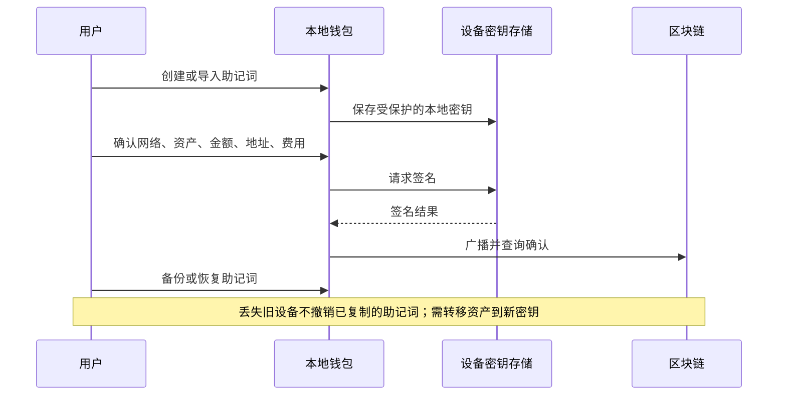
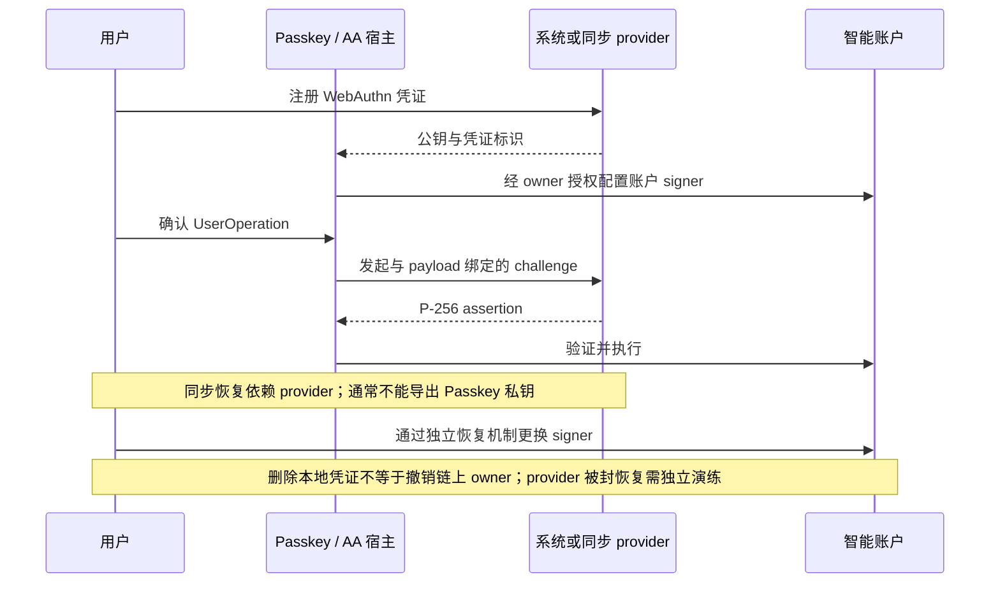
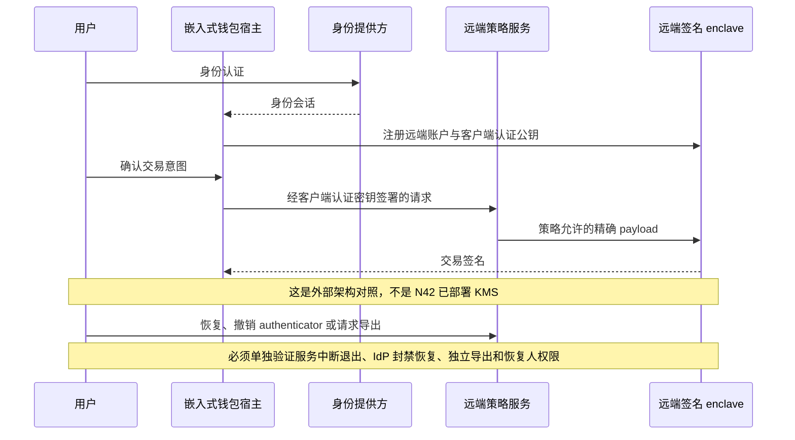

# 账户控制与恢复边界

三条流程是威胁模型，不是三种 N42 账户都已生产可用的声明。Passkey 的设备绑定/同步取决于具体 provider；不能把 Passkey 登录等同于链上账户控制权。

源码证据：`core/wallet_sdk`、`core/passkey`、`features/wallet/aa/recovery`、`features/wallet/mpc`。接口存在不保证供应商可用、门限 MPC/远端 enclave 实际部署或独立退出路径通过。
