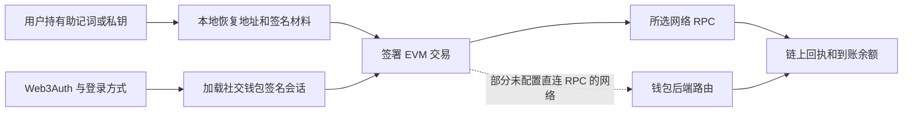

# N42 钱包周报实施与验收

周报资料窗口为 2026 年 11 月 6–13 日。代码基线为 `54bb0e58a`，本地验证日期为 11 月 18 日。

## 来源核对

- Web3Auth 于 11 月 7 日公布嵌入式钱包服务暂停，11 月 12 日宣布有条件恢复。11 月 23 日的预期适用于部分旧网络的新用户开户。Facebook 登录在恢复公告中单独列为暂停事项。Flutter v6 应迁移到 v7，N42 当前锁定 `web3auth_flutter 7.0.1`。 [事件公告](https://builder.metamask.io/t/a-security-incident-with-web3auth-embedded-wallets/3663) · [恢复及 SDK 迁移说明](https://builder.metamask.io/t/web3auth-embedded-wallets-service-restored-what-you-need-to-know/3690)
- Trust Wallet 的客服经同意可查询并共享部分钱包资料。Bitget 的 90.2% 衡量 AI 参与识别新封禁域名的比例。两项材料支持先验证只读诊断和签名前的确定性规则。 [Trust Wallet 公告](https://trustwallet.com/blog/product/customer-support-is-now-smarter-with-ai-powered-help) · [Bitget Wallet 公告](https://web3.bitget.com/en/blog/articles/ai-threat-detection)

## P0 恢复与退出演练

手机宿主通过构建配置开启 MPC。钱包记录持久化供应商、用户标识和地址等元数据。Dart 层在供应商会话中加载私钥并本地签名。没有证据确认实际发行宿主的开关、原生 SDK 会话保留期限或服务商停运后的社交钱包退出路径。

| 场景 | 本轮证据 |
| --- | --- |
| 助记词与私钥恢复 | 两个合成账户各自恢复原地址。使用桌面密码学适配器执行 BIP39、BIP32 和 EVM 签名，通过应用实际 `EvmSender` 广播。 |
| 默认 RPC 503 | 两次均在签名前停止。显式替换为本地 Anvil RPC 后，两次转账均取得成功回执，发送者、收款者和收款余额相符。 |
| Web3Auth 中断 | 注入平台通道故障。已加载会话保留原地址与本地签名能力，冷启动不提供地址或签名能力，重新登录失败且未签名。 |

测试只使用临时资产和合成密钥。HTTP 测试夹具禁止外部连接，记录到的外部连接尝试为 0。移动端原生导入、Keystore、真实设备丢失、社交钱包冷恢复与生产广播仍待验收。运行回环测试时，将 `N42_RECOVERY_LOOPBACK_RPC` 指向本机链 ID 31337 的 Anvil，再运行 `flutter test --no-pub test/features/wallet/api/sender/evm_offline_recovery_test.dart`。

## P1 签名前确认

- DApp 浏览器与 WalletConnect 复用 Permit2 授权解码。预览逐项显示代币和额度、完整 spender、签名域的合约与链 ID，并突出显示达到 Permit2 uint160 上限的额度。用户仍需确认签名。 [Uniswap Permit2 接口](https://github.com/Uniswap/permit2/blob/main/src/interfaces/IAllowanceTransfer.sol)
- WalletConnect 把请求所选网络的测试网标记传入模拟。模拟只在 `eth_call` 返回合法十六进制字节数据时显示通过。缺失值、空值、非法字符或半字节结果均显示不可用，明确执行回滚继续显示失败。 [Ethereum JSON-RPC](https://ethereum.org/developers/docs/apis/json-rpc/#eth_call)
- 本地生成 100 个有上限和 100 个最大额度样本，覆盖 ERC-20 approve、EIP-2612 Permit、Permit2 单项和批量。200 个样本均生成预期的授权对象、合约与额度字段。以最大额度为该样本集的风险标签，误报和漏报均为 0。本轮本地样本构造及解码 p95 为 260 微秒。真实 DApp 样本、端到端模拟 p95 和链上语义仍待验收。

## P2 只读交易诊断

现有交易详情把回执查询失败与链上确实暂无回执分开显示。查不到状态时保留自动重试并隐藏加速、取消入口。已取得的有效回执在暂时查询失败时保留。当前实现使用既有的只读 RPC 路径。10 人、30 个脱敏案例的对照实验与用户解决率仍待执行。

## 验证记录

相关自动化测试 238 项通过。独立 Anvil 演练 1 项通过，涵盖两个账户各自的恢复和备用 RPC 转账。全仓静态分析退出码为 0，报告 78 条 info、0 条 warning、0 条 error。
